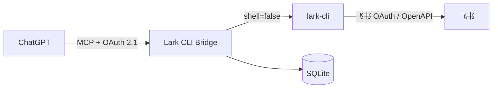

# Lark CLI Bridge

把官方 [Lark CLI](https://github.com/larksuite/cli) 接入 ChatGPT 的个人 MCP Bridge。

项目提供远程 Streamable HTTP MCP、OAuth 2.1 授权，以及一组受控的飞书工具；需要更多能力时，可以在授权页为单次连接开启完整 CLI 权限。Bridge 复用 Lark CLI 的登录态，不接管或转发飞书访问令牌。

> 当前定位是单用户、自托管项目。请勿把实例作为无隔离的公共服务提供给其他人。

## 工作方式



- `POST /mcp` 提供无状态 JSON-RPC MCP 接口。
- OAuth 使用授权码、PKCE S256、动态客户端注册和刷新令牌。
- OAuth 客户端只允许注册 `chatgpt.com` 与 `chat.openai.com` 的 HTTPS 回调。
- Bridge 令牌的哈希、OAuth 客户端和自动允许的文档 ID 保存在 SQLite 中。
- 飞书凭证由官方 CLI 保管；Linux 容器中的凭证以加密文件保存到持久卷。

## MCP 工具

| 工具 | 能力 | 权限 |
| --- | --- | --- |
| `list_wiki_spaces` | 列出可访问的知识空间 | 读 |
| `list_personal_documents` | 浏览个人文档库根目录 | 读 |
| `list_base_tables` | 列出多维表格的数据表 | 读 |
| `list_base_fields` | 查询数据表字段 | 读 |
| `list_base_records` | 查询数据表记录 | 读 |
| `create_base_record` | 新增多维表格记录 | 写 |
| `read_document` | 读取允许列表中的云文档 | 读 |
| `append_document` | 向允许列表中的云文档追加 Markdown | 写 |
| `create_document` | 在个人文档库创建云文档 | 写 |
| `run_lark_cli` | 调用 CLI 的其他非交互命令 | 完全权限 |

受限模式暴露前 9 个工具。完全模式额外暴露 `run_lark_cli`，因此可以使用当前版本 Lark CLI 支持的日历、任务、消息、云盘、表格、审批等能力。

## 权限模型

`BRIDGE_PERMISSION_MODE` 控制服务器允许授予的最高权限：

- `restricted`：只提供固定工具，并执行 Base、文档白名单。
- `full`：OAuth 页面出现“受限权限”和“完全权限”选项。选择完全权限后，当前连接可调用 `run_lark_cli`。

完全权限继承 Bridge 进程能访问的 CLI 身份、网络和文件。在 Docker 中，本地文件访问限制在容器文件系统以及显式挂载的 `/workspace` 和 `/state`；在本机运行时则继承当前操作系统用户的权限。

## Docker 部署

### 1. 准备配置

需要 Docker Engine 24+ 与 Compose v2。复制环境变量模板：

```bash
cp .env.example .env
```

至少修改下面几项：

```dotenv
PUBLIC_URL=https://bridge.example.com
OWNER_PASSWORD=替换为至少16位的随机密码
MOCK_CLI=0
BRIDGE_PERMISSION_MODE=full
ALLOWED_BASE_TOKENS=
ALLOWED_DOC_TOKENS=
```

`PUBLIC_URL` 是外部访问 Bridge 的固定 HTTPS 根地址，不包含 `/mcp`。Docker Compose 会覆盖容器内的 `HOST`、`PORT`、`DB_PATH`、`CLI_WORKDIR` 和 `LARK_CLI_PATH`，这些值无需为容器修改。

### 2. 构建镜像

```bash
docker compose build
```

镜像默认固定安装 Lark CLI `1.0.97`。升级时可以在 `.env` 增加：

```dotenv
LARK_CLI_VERSION=1.0.98
```

然后重新执行 `docker compose build --pull`。升级前建议先查看官方 CLI 的变更记录。

### 3. 在容器中配置并登录飞书

首次部署需要在容器里完成一次 CLI 配置和用户授权：

```bash
docker compose run --rm bridge lark-cli config init --new
docker compose run --rm bridge lark-cli auth login --recommend
docker compose run --rm bridge lark-cli auth status --json --verify
```

按终端输出打开飞书授权地址即可。配置与凭证保存在 `bridge-state` 命名卷，容器重新创建后仍然有效。

Windows 主机上的 Lark CLI 登录态使用 Windows 凭证保护，不能直接复制进 Linux 容器；容器首次启动必须重新授权一次。

### 4. 启动和检查

```bash
docker compose up -d
docker compose ps
docker compose logs -f bridge
curl http://127.0.0.1:8765/health
```

服务只映射到宿主机 `127.0.0.1:8765`。请在前面部署 HTTPS 反向代理或隧道，不要直接把 8765 端口暴露到公网。

停止服务不会删除数据：

```bash
docker compose down
```

`docker compose down -v` 会删除 Bridge OAuth 数据库、飞书 CLI 配置和加密凭证，请谨慎使用。

### 5. 容器文件交换

完全权限模式需要上传或下载本地文件时，统一使用 `/workspace`：

```bash
docker compose cp ./input.xlsx bridge:/workspace/input.xlsx
docker compose cp bridge:/workspace/output.xlsx ./output.xlsx
```

CLI 的默认工作目录也是 `/workspace`。

## HTTPS 与 ChatGPT

ChatGPT 无法访问本机 `127.0.0.1`，需要固定的公网 HTTPS 地址。可以使用 Caddy、Nginx、Traefik，或 [Cloudflare Tunnel](https://developers.cloudflare.com/cloudflare-one/connections/connect-networks/) 将域名转发到 `http://127.0.0.1:8765`。

反向代理需要保留以下路径：

- `/mcp`
- `/authorize`
- `/token`
- `/register`
- `/.well-known/oauth-authorization-server`
- `/.well-known/oauth-protected-resource`
- `/.well-known/oauth-protected-resource/mcp`

部署后检查元数据中的 URL 是否都是你的公网域名：

```bash
curl https://bridge.example.com/health
curl https://bridge.example.com/.well-known/oauth-authorization-server
curl https://bridge.example.com/.well-known/oauth-protected-resource/mcp
```

在 ChatGPT 中创建自定义 MCP：

1. 打开 Settings → Apps，并启用开发者模式。
2. 创建自定义 MCP，服务器 URL 填 `https://bridge.example.com/mcp`。
3. 身份验证选择 OAuth，客户端配置使用动态注册。
4. 在 Bridge 授权页选择权限级别并输入 `OWNER_PASSWORD`。
5. 扫描完成后应看到受限模式 9 个工具，或完全模式 10 个工具。

ChatGPT 会保存工具快照。服务器增加或修改工具后，需要在应用设置中执行 **Refresh / Scan Tools**；旧 OAuth 令牌也不会自动升级权限。参见 [OpenAI 的自定义 MCP 应用说明](https://help.openai.com/en/articles/12584461-developer-mode-and-mcp-apps-in-chatgpt)。

## 本机运行

### Windows

安装并登录官方 CLI：

```powershell
npx @larksuite/cli@latest install
lark-cli config init --new
lark-cli auth login --recommend
lark-cli auth status --json --verify
```

然后启动 Bridge：

```powershell
Copy-Item .env.example .env
notepad .env
powershell -ExecutionPolicy Bypass -File .\scripts\start.ps1
```

Bridge 会优先寻找 `lark-cli.exe`。如自动发现失败，用 `where.exe lark-cli` 查找位置，并让 `LARK_CLI_PATH` 指向官方原生可执行文件。为避免 Shell 注入，Windows 下不接受 `.cmd` 或 `.bat` 包装器。

### Linux / macOS

```bash
python3 -m venv .venv
. .venv/bin/activate
pip install -r requirements.txt
cp .env.example .env
python -m scripts.run
```

本机模式会复用当前用户已有的 Lark CLI 配置和登录态。

## 配置项

| 变量 | 默认值 | 说明 |
| --- | --- | --- |
| `PUBLIC_URL` | `http://127.0.0.1:8765` | 外部根地址；公网必须为 HTTPS |
| `HOST` | `127.0.0.1` | HTTP 监听地址 |
| `PORT` | `8765` | HTTP 监听端口 |
| `OWNER_PASSWORD` | 本地开发密码 | OAuth 授权页密码；公网至少 16 位 |
| `MOCK_CLI` | `0` | `1` 时使用离线 Mock；禁止与公网 URL 同时使用 |
| `BRIDGE_PERMISSION_MODE` | `restricted` | `restricted` 或 `full` |
| `LARK_CLI_PATH` | 自动查找 | CLI 可执行文件路径 |
| `ALLOWED_BASE_TOKENS` | 空 | 受限工具允许访问的 Base token，逗号分隔 |
| `ALLOWED_DOC_TOKENS` | 空 | 受限工具允许访问的文档 token，逗号分隔 |
| `DB_PATH` | `data/bridge.sqlite3` | Bridge SQLite 数据库 |
| `CLI_TIMEOUT` | `25` | 固定工具的 CLI 超时秒数 |
| `CLI_WORKDIR` | 项目根目录 | CLI 的本地文件工作目录 |

由 Bridge 创建的文档会自动写入 SQLite 允许列表，不必再修改 `ALLOWED_DOC_TOKENS`。

## 安全边界

- 所有 MCP 调用都要求有效的 OAuth Bearer Token，并检查资源与 scope。
- Bridge 使用 `subprocess.run(..., shell=False)`，不会把 CLI 参数交给系统 Shell。
- 文档正文通过 stdin 传递，避免 `@文件名` 被 CLI 解释成本地文件引用。
- 受限工具校验参数、Base 白名单和文档白名单。
- 完全权限允许调用全部非交互 CLI 命令，可能创建、移动、删除飞书资源或访问文件。
- Access Token 有效期 1 小时；Refresh Token 有效期 30 天并单次轮换；数据库只保存令牌哈希。
- OAuth 密码失败限制为每个进程、每个 IP、10 分钟内 5 次；公网仍应在代理层增加限流和访问日志。
- `.env`、SQLite 数据库、容器状态卷和 CLI 凭证都不得提交或分享。

如果实例疑似泄露，立即停止服务、修改 `OWNER_PASSWORD`、删除 Bridge SQLite 数据库，并在飞书 CLI 中撤销或重新授权账号。

## 已知限制

- 实现的是 MCP Streamable HTTP 的无状态 JSON 请求/响应子集，没有 SSE 通知。
- 交互式 TUI、长期事件订阅和超过 120 秒的命令不适合通过 `run_lark_cli` 执行。
- 写入请求超时后结果可能已经生效；再次写入前应先查询，避免重复记录。
- 长文档追加受 Lark CLI 版本行为影响，写入后建议读回核对。
- 当前 OAuth 客户端注册只支持 ChatGPT 官方回调域名。

## 开发与测试

```bash
pip install -r requirements-dev.txt
python -m pytest -q
```

测试覆盖 OAuth 元数据、DCR、PKCE、密码校验、令牌轮换、MCP 初始化、工具列表、Mock CLI、白名单、文档创建、Origin 校验、完全权限 scope 和并发响应。

项目结构：

```text
bridge/          MCP、OAuth、CLI 调用与工具定义
scripts/         启动脚本、Mock CLI、冒烟测试
tests/           自动化测试
Dockerfile       容器镜像
compose.yaml     单实例部署与持久卷
workspace/       本机开发时的文件交换目录
```

增加受限工具时，请在 `bridge/tools.py` 中定义明确的参数 schema、读写属性和固定 CLI 映射，并补充覆盖权限边界的测试。

## License

本项目采用 [MIT License](./LICENSE)。

## 相关项目

- [Lark CLI](https://github.com/larksuite/cli)
- [Model Context Protocol](https://modelcontextprotocol.io/)
- [ChatGPT MCP 应用开发者模式](https://help.openai.com/en/articles/12584461-developer-mode-and-mcp-apps-in-chatgpt)
